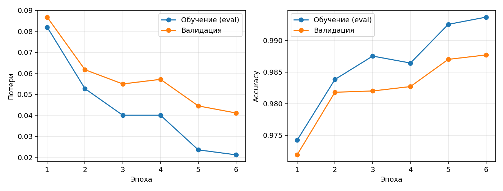
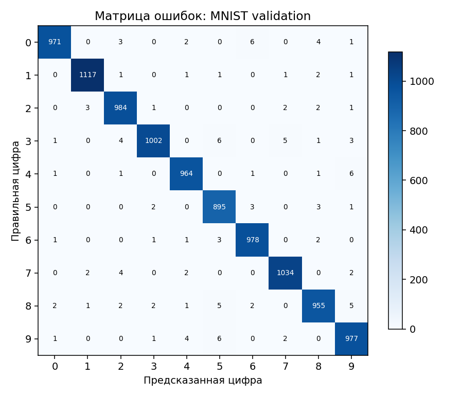
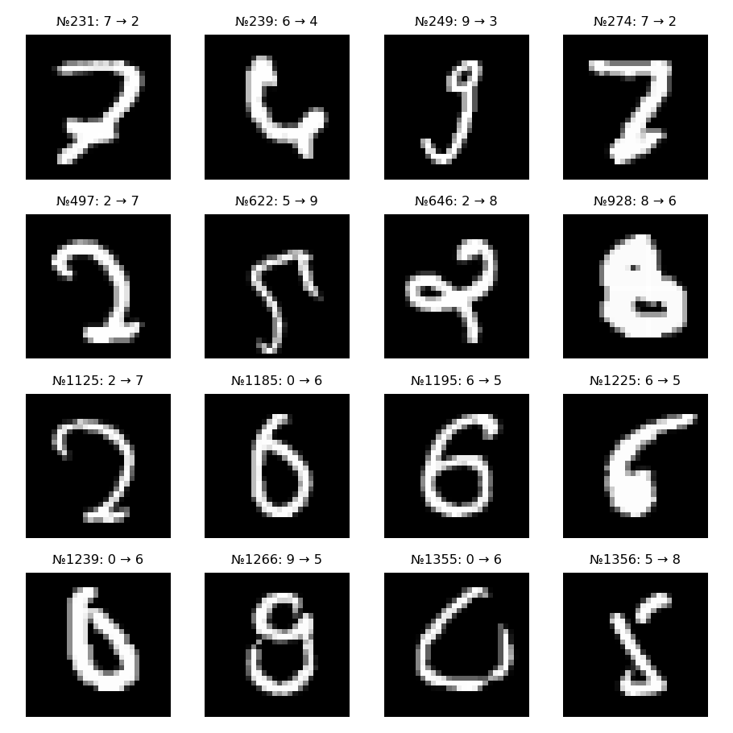

# Лабораторная работа №3. Классификация рукописных цифр

Цель — обучить небольшую свёрточную нейронную сеть на Python, PyTorch и
Torchvision распознавать цифры 0–9, измерить качество на валидации и затем
проверить перенос на независимо собранные рисунки пользователя.

Работа изолирована в `digit-classifier`. Первую лабораторную в соседней
папке `CV` и её окружение не меняем. Окружение `CV/lab3/.venv` не используется.
Этапы и критерии готовности перечислены в [PLAN.md](PLAN.md).

## Теория и данные

Свёртка ищет локальные признаки (штрихи, границы, дуги) общими обучаемыми
фильтрами. ReLU добавляет нелинейность; MaxPool уменьшает пространственный
размер. Полносвязные слои объединяют признаки и выдают десять logits.
`CrossEntropyLoss` сочетает log-softmax с отрицательным логарифмом вероятности
правильного класса. Поэтому softmax перед loss отсутствует; при распознавании
softmax используется только для вывода вероятностей. Adam обновляет веса,
используя скользящие оценки первого и второго моментов градиента.

Источник обучения — `torchvision.datasets.MNIST(train=True)`, 60 000
изображений в оттенках серого размером 28×28. Из них **50 000** идут в train,
**10 000** — в validation. Разбиение стратифицировано: для каждого класса
validation получает приблизительно 1/6 примеров, округление методом
наибольших остатков даёт ровно 10 000. Отклонение от точной квоты меньше
одного изображения. Seed генератора NumPy — **42**. Индексы и SHA-256 меток
сохраняются в `splits/mnist_seed42.json`, копия — рядом с checkpoint.
Проверяются полное покрытие 60 000 индексов, уникальность, отсутствие
пересечений, пропорции классов, seed и контрольная сумма меток.

Официальный MNIST test не используется для выбора модели или измерений
этого отчёта. Torchvision при скачивании может загрузить и его файлы.
Validation служит выбору лучшей эпохи, поэтому не заменяет независимый тест.

**Собственный тест ещё не собран и не проведён.** Требуются минимум пять
разных нарисованных пользователем изображений каждой цифры, всего ≥50.
Ни MNIST, ни искусственные фигуры из unit-тестов не выдаются за этот набор.
Тестовые рисунки не читаются обучением и не используются для подбора параметров.

## Архитектура и параметры

| Слой | Выход без batch | Параметры |
|---|---|---:|
| Вход | 1×28×28 | 0 |
| Conv2d 1→16, 3×3, padding=1; ReLU | 16×28×28 | 160 |
| MaxPool2d 2×2 | 16×14×14 | 0 |
| Conv2d 16→32, 3×3, padding=1; ReLU | 32×14×14 | 4 640 |
| MaxPool2d 2×2; Flatten | 1568 | 0 |
| Linear 1568→64; ReLU; Dropout p=0.25 | 64 | 100 416 |
| Linear 64→10 | 10 logits | 650 |
| **Всего** | | **105 866** |

Обучение: 6 эпох, batch size 128, Adam, learning rate 0.001,
`betas=(0.9,0.999)`, `eps=1e-8`, weight decay 0. CrossEntropyLoss без весов
классов и label smoothing. Аугментации и scheduler не применяются.
Компактные слои и загрузка нормализованных MNIST-тензоров в RAM позволяют
обучать на CPU. Dropout снижает зависимость от отдельных скрытых признаков.
Лучший checkpoint выбирается **только по минимальному validation loss**.

Вход: float32, `[N,1,28,28]`, светлые штрихи на тёмном фоне,
`x = (pixel/255 - 0.1307)/0.3081`. MNIST уже приведён к нужной геометрии.
Для внешнего изображения общий модуль `images.py` переводит его в grayscale,
определяет полярность по границе, обрезает фон, вписывает цифру в 20×20
с сохранением пропорций, добавляет чёрное поле до 28×28 и центрирует по
центру масс; затем применяет ту же нормализацию. Прозрачный PNG сначала
компонуется на белый фон. Предполагается одна цифра на однородном фоне.
Исходный рисунок хранится без этой обработки, чтобы не обрабатывать его дважды.

Метрики: accuracy = число верных / число изображений;
F1 класса = `2TP/(2TP+FP+FN)`, macro F1 — среднее F1 по десяти классам
с одинаковым весом. Для нулевого знаменателя F1=0. Loss усредняется по
изображениям, включая неполный последний batch. В матрице ошибок строки
соответствуют истинным меткам, столбцы — предсказаниям.

## Окружение и команды PowerShell

Нужен 64-битный Python 3.11–3.13 с Tkinter (проверяется на Python 3.13.7),
Windows/Linux/macOS с графическим экраном для сборщика. Практический ориентир:
≥4 ГБ RAM и ≥1 ГБ свободного диска для окружения и данных; GPU не требуется.
Первичная установка и скачивание MNIST требуют доступа к интернету.
Команды выполняются **из папки digit-classifier**. Активация окружения
и изменение ExecutionPolicy не нужны.

```powershell
python -m venv .venv
.\.venv\Scripts\python.exe -m pip install torch==2.9.1 torchvision==0.24.1 --index-url https://download.pytorch.org/whl/cpu
.\.venv\Scripts\python.exe -m pip install -r requirements.txt
.\.venv\Scripts\python.exe -m pytest -q
```

Основные версии закреплены в `requirements.txt`. Полный фактический состав
окружения записывается в `requirements-lock-cpu.txt`. Для точного повторения
на Windows/Python 3.13 используйте этот файл вместо `requirements.txt`
после установки той же пары CPU-колёс. Версии Python, библиотек, CPU, ОС,
число потоков и параметры эксперимента сохраняются в `config.json`.

```powershell
.\.venv\Scripts\python.exe -m digit_classifier train --epochs 6 --batch-size 128 --lr 0.001 --seed 42 --threads 4 --device auto --download --data-dir data --split splits/mnist_seed42.json --output results/baseline
```

При `--device auto` выбирается CUDA, если она доступна PyTorch, иначе CPU.
Установленная здесь сборка CPU не включает CUDA. Для GPU установите пару
torch/torchvision той же версии с подходящим CUDA-индексом по официальной
таблице PyTorch. Явные варианты: `--device cpu` и `--device cuda`;
недоступная явно запрошенная CUDA вызывает понятную ошибку.

Если `results/baseline` уже содержит результаты, укажите новую папку,
например `--output results/repeat`. Существующие эксперименты не затираются.
Для другого seed задайте и новый путь, например
`--seed 7 --split splits/mnist_seed7.json --output results/seed7`.
После успешного скачивания `--download` можно убрать.
Checkpoint сохраняет веса и метаданные для инференса; возобновление Adam
с середины эпохи не реализовано, новый запуск обучает с начала.

Повторная оценка зафиксированной модели на том же validation:

```powershell
.\.venv\Scripts\python.exe -m digit_classifier evaluate --checkpoint results/baseline/best.pt --dataset validation --data-dir data --device cpu --output results/validation_recheck
```

Используется `split.json` рядом с checkpoint; его SHA-256 должен совпасть.
Загрузка выполняется через `state_dict`, `weights_only=True`, `map_location`
и `model.eval()` согласно официальному руководству. Случайные seed заданы
для Python, NumPy, PyTorch; включены детерминированные алгоритмы.
Одинаковые версии и платформа важны: полное побитовое совпадение между
разными CPU/GPU и версиями библиотек не гарантируется.

## Сбор собственных изображений

Сначала зафиксируйте модель и параметры, затем соберите весь тест, не
выбирая рисунки по предсказаниям модели:

```powershell
.\.venv\Scripts\python.exe -m digit_classifier collect --output custom_test
```

Рисуйте одну цифру левой кнопкой мыши, выбирайте правильную метку 0–9,
нажимайте «Сохранить». После сохранения холст очищается. «Очистить» удаляет
неудачный рисунок. Счётчики показывают число примеров каждой цифры и общий
объём; соберите ≥5 на класс. Желательны разные начертания, возможно несколько
авторов; не делайте копии одного файла. Пустые рисунки и точные дубликаты
отклоняются. Семантическую правильность метки обеспечивает пользователь.
Сборщик не показывает прогнозы и не загружает модель.

Исходные PNG 280×280 хранятся в `custom_test/raw/`,
`custom_test/labels.csv` содержит относительный путь, ручную метку и время UTC.
Папка исключена из Git, чтобы рисунки не публиковались автоматически.

После завершения сбора выполните **одну независимую итоговую оценку**:

```powershell
.\.venv\Scripts\python.exe -m digit_classifier evaluate --checkpoint results/baseline/best.pt --dataset custom --custom-dir custom_test --device auto --output results/custom_test
```

Проверяются количество, все десять классов, минимум пять на каждый,
метки, читаемость PNG, непустой рисунок, уникальные пути и содержимое,
отсутствие PNG без CSV-разметки и выхода пути за пределы набора.
Отчёт содержит loss, accuracy, macro F1, F1 по классам, матрицу ошибок,
примеры ошибок, все предсказания и контрольные суммы модели/тестовых файлов.
Если после теста менять модель по его ошибкам, этот набор перестаёт быть
независимым итоговым тестом; для новой итоговой оценки нужны новые рисунки.

Распознавание отдельного **исходного** файла:

```powershell
.\.venv\Scripts\python.exe -m digit_classifier predict custom_test/raw/ИМЯ_ФАЙЛА.png --checkpoint results/baseline/best.pt --device cpu --save-preprocessed results/single_preprocessed.png
```

Замените `ИМЯ_ФАЙЛА.png` на существующий файл. CLI выводит цифру и десять
вероятностей softmax; это оценки модели, не гарантия правильности.
Обработанную копию сохраняйте вне `custom_test`, чтобы не добавить
неразмеченный PNG в тестовый набор.

## Результаты и анализ переобучения

Реальное обучение выполнено **2 ноября 2026 года** на CPU, Windows 11,
Python 3.13.7, PyTorch 2.9.1+cpu, Torchvision 0.24.1+cpu, четыре потока.
Шесть эпох вместе с измерениями и построением отчётов заняли **58,16 с**;
скорость зависит от компьютера. Полная конфигурация:
[config.json](results/baseline/config.json).

| Эпоха | Train loss (eval) | Validation loss | Train accuracy | Validation accuracy | Validation macro F1 |
|---:|---:|---:|---:|---:|---:|
| 1 | 0,08199 | 0,08674 | 97,422% | 97,190% | 0,97169 |
| 2 | 0,05272 | 0,06172 | 98,382% | 98,180% | 0,98164 |
| 3 | 0,04006 | 0,05495 | 98,752% | 98,200% | 0,98189 |
| 4 | 0,04006 | 0,05713 | 98,642% | 98,270% | 0,98259 |
| 5 | 0,02358 | 0,04449 | 99,254% | 98,700% | 0,98693 |
| **6** | **0,02121** | **0,04113** | **99,368%** | **98,770%** | **0,98756** |



Лучшая модель — эпоха 6: на 10 000 validation-изображений верно распознаны
**9877**, допущены **123 ошибки**. Train macro F1 = 0,99364.
Отдельный CLI-запуск загрузил `best.pt` и повторил оценку: все метрики,
матрица ошибок и индексы показанных ошибок **совпали точно** с первоначальным
отчётом. Файлы: [итог](results/baseline/summary.json),
[история CSV](results/baseline/history.csv),
[метрики по классам](results/baseline/validation/metrics.json),
[повторная оценка](results/validation_recheck/metrics.json).





На рисунке показаны первые 16 ошибок в фиксированном порядке validation;
номер — индекс внутри оцениваемой выборки. Исходный индекс MNIST можно
получить как `split['validation'][номер]`. Среди показанных примеров есть
необычные и похожие начертания 7/2, 0/6, 5/9. Это наблюдение по примерам,
а не доказательство причины каждой ошибки.

Для сравнения train/validation loss и accuracy обе выборки оцениваются
после каждой эпохи на одних весах в `eval`-режиме (Dropout выключен).
`optimization_loss` отдельно сохраняет loss во время обновления весов
с включённым Dropout; он не подменяет сопоставимый train loss на графике.
На эпохе 4 validation loss вырос с 0,05495 до 0,05713, тогда как train loss
изменился лишь с 0,040058 до 0,040055, а train accuracy снизилась.
На эпохах 5–6 validation loss снова уменьшался и достиг минимума на
последней эпохе. **Устойчивого ухудшения validation в этом запуске не видно**;
одиночная флуктуация не доказывает переобучение. Разрыв accuracy в конце
равен **0,598 процентного пункта**, разрыв loss — около 0,01991.
Более долгое обучение может дать другую динамику.
Подробности: [анализ](results/baseline/overfitting.md).

Стратифицированное разбиение по классам:

| Цифра | Train | Validation |
|---:|---:|---:|
| 0 | 4936 | 987 |
| 1 | 5618 | 1124 |
| 2 | 4965 | 993 |
| 3 | 5109 | 1022 |
| 4 | 4868 | 974 |
| 5 | 4517 | 904 |
| 6 | 4932 | 986 |
| 7 | 5221 | 1044 |
| 8 | 4876 | 975 |
| 9 | 4958 | 991 |
| **Всего** | **50 000** | **10 000** |

## Выводы и оставшийся этап

Небольшая CNN обучилась на CPU менее чем за минуту в данном окружении и
дала 98,77% accuracy на MNIST validation. Веса, разбиение и результаты
проверены повторной загрузкой. Эти числа характеризуют только MNIST
validation, использованный при выборе checkpoint; они не устанавливают
качество на новом способе ввода. Мышь, толщина штриха и стиль написания
создают отличие от распределения MNIST даже после согласования формата.

**Собственный независимый тест ещё не проведён.** Пользователю осталось
запустить `collect`, нарисовать и разметить ≥50 примеров (≥5 на класс),
затем выполнить `evaluate --dataset custom` по командам выше и дополнить
отчёт фактическими метриками и сравнением с validation. До этого этапа
лабораторная не считается полностью завершённой по требованию сбора теста.

## Структура и проверка

```text
digit_classifier/          модель, данные, предобработка, обучение, отчёты, CLI, Tkinter
tests/test_core.py         критические и интеграционные проверки
splits/                   сохранённые индексы MNIST
results/baseline/          небольшие графики, конфигурация, история и отчёты
data/                     скачанный MNIST (исключён из Git)
custom_test/              личные рисунки и разметка (исключены из Git)
.venv/                    новое окружение (исключено из Git)
```

`best.pt` также исключён из Git. Маленькие PNG/JSON/CSV/Markdown-отчёты
сохраняются для README. После клонирования checkpoint нужно получить
обучением по указанной команде. Автоматической публикации или отправки нет.

Проверки покрывают split, выход `[N,10]`, шаг оптимизатора, сохранение и
загрузку весов, форму/полярность/центрирование рисунка, пустой рисунок,
прозрачность, CSV, дубликаты, неполный набор, формулы метрик и выбор
лучшего checkpoint. Интеграционные фикстуры находятся только во временной
папке pytest, а не в данных лабораторной.

Фактически прошли **14 тестов нового проекта** и **9 тестов лабораторной №1**;
`pip check` не обнаружил конфликтов. Tkinter 8.6 и сборщик успешно
инициализированы в скрытом окне вне песочницы. В песочнице доступ к Tcl
ограничен и возникает `Can't find a usable init.tcl`, хотя файл установлен;
сборщик следует запускать в обычном пользовательском PowerShell.
Подробный протокол: [verification.md](reports/verification.md).

Тесты первой лабораторной без записи bytecode и кэша:

```powershell
Push-Location ..\CV
$env:PYTHONDONTWRITEBYTECODE = '1'
.\.venv\Scripts\python.exe -m pytest -q -p no:cacheprovider
Remove-Item Env:PYTHONDONTWRITEBYTECODE
Pop-Location
```

## Источники

1. [Torchvision: MNIST](https://docs.pytorch.org/vision/main/generated/torchvision.datasets.MNIST) — интерфейс загрузки и флаг train.
2. [PyTorch: Saving and Loading Models](https://docs.pytorch.org/tutorials/beginner/saving_loading_models) — state_dict, weights_only, eval и перенос между устройствами.
3. [CrossEntropyLoss, PyTorch 2.9](https://docs.pytorch.org/docs/2.9/generated/torch.nn.CrossEntropyLoss.html) — loss принимает logits.
4. [Adam, PyTorch 2.9](https://docs.pytorch.org/docs/2.9/generated/torch.optim.Adam.html) — алгоритм и параметры по умолчанию.
5. [Официальные пары версий PyTorch/Torchvision](https://pytorch.org/get-started/previous-versions/#v291) — установка CPU/CUDA.
6. [Torchvision: преобразования](https://docs.pytorch.org/vision/0.24/transforms.html) — масштабирование и нормализация тензоров.
