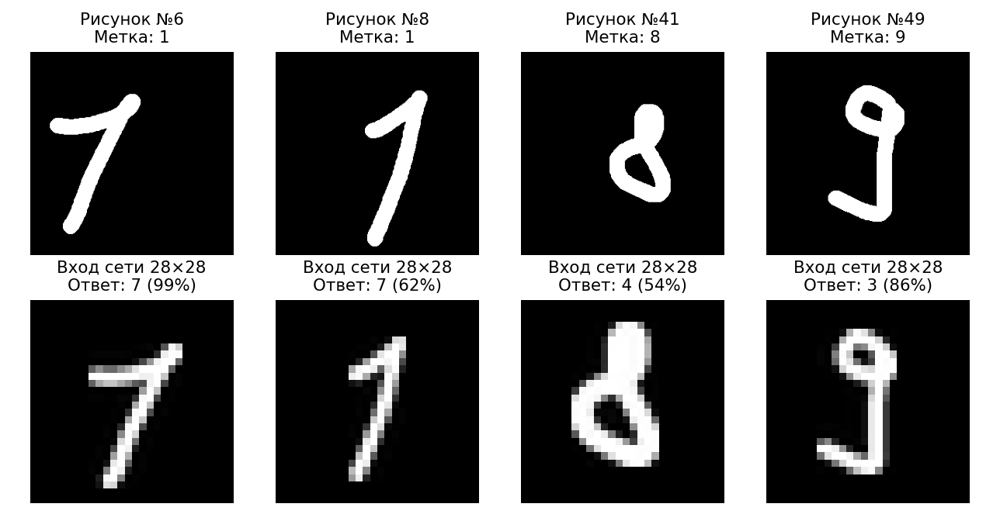
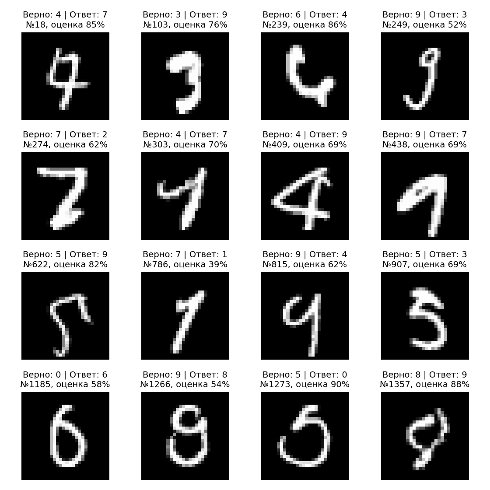
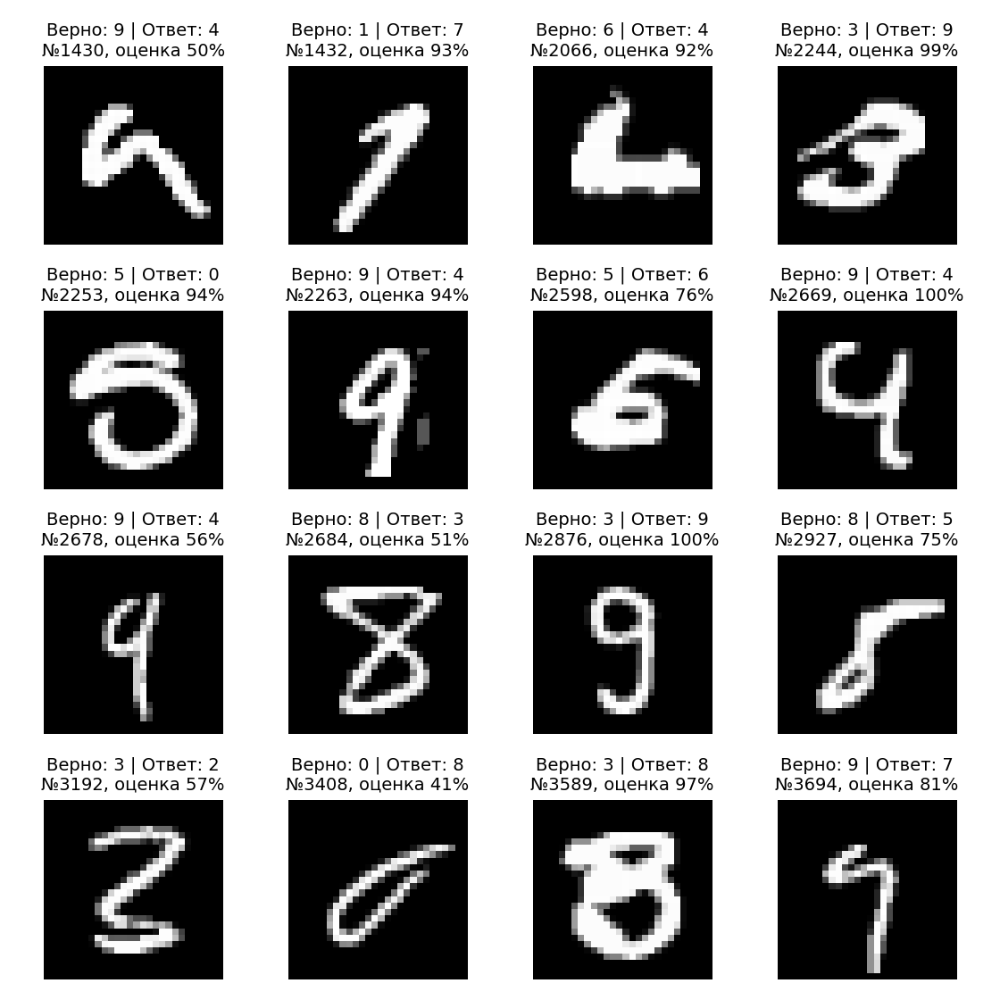
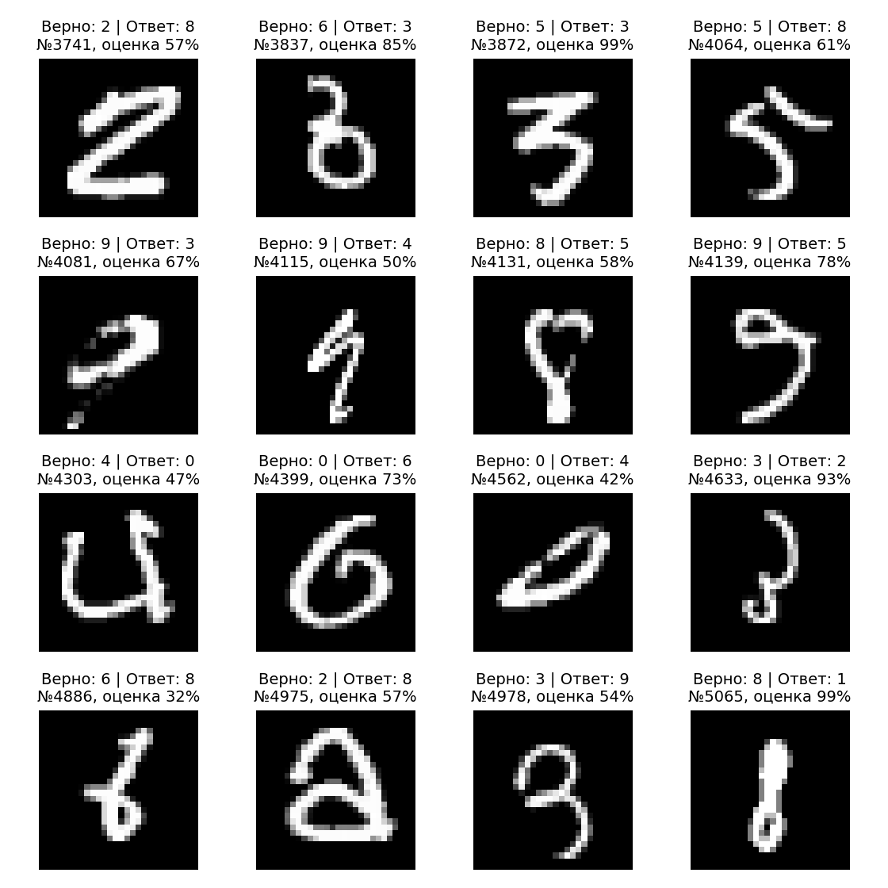
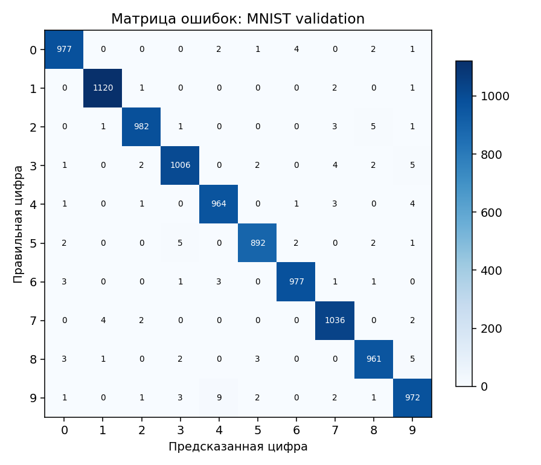
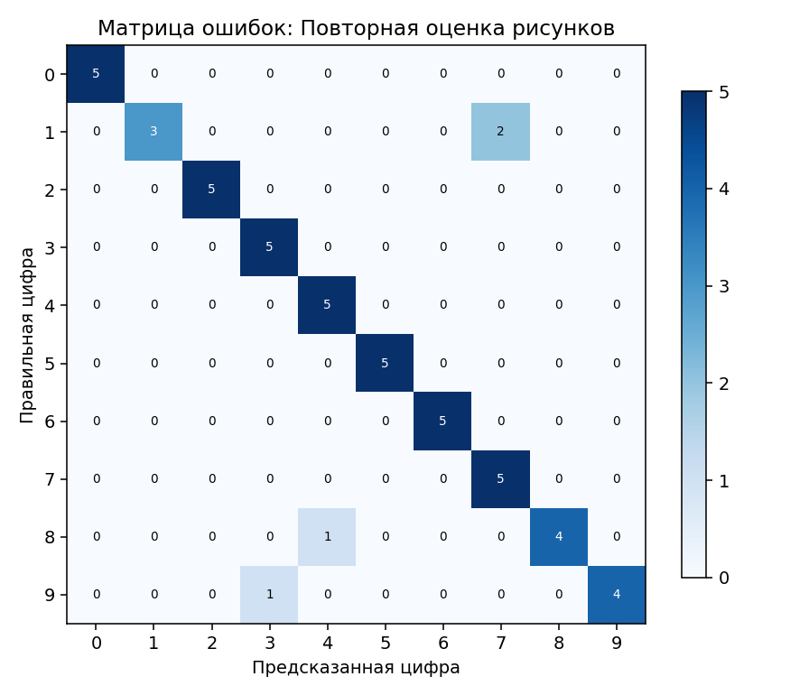
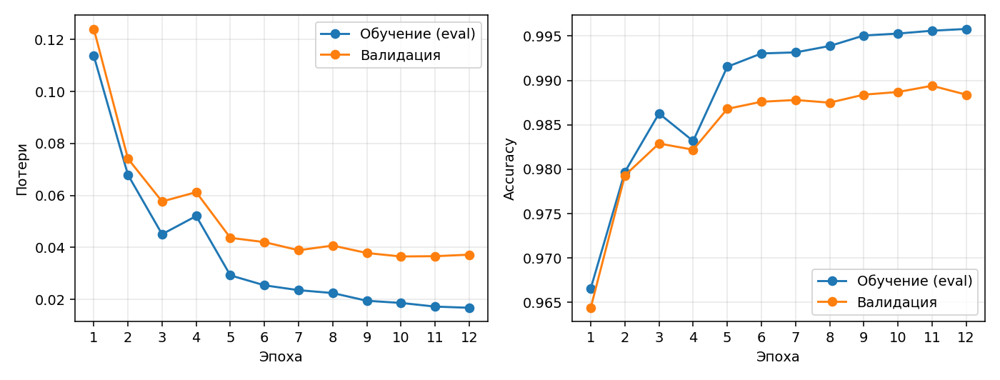

# Лабораторная работа №3. Распознавание рукописных цифр

Программа получает картинку с одной цифрой и пытается определить, что на ней написано. Для этого используется небольшая нейросеть на PyTorch, обученная на MNIST.

Модель уже обучена. [Готовые веса best.pt](results/lenet_sgd/best.pt) лежат в репозитории и занимают около 246 КБ. Их можно сразу использовать после установки зависимостей.

## Что получилось

| На чём проверяли | Верных ответов | Точность |
|---|---:|---:|
| Валидация MNIST | 9887 из 10000 | **98,87%** |
| Собственные рисунки мышью | 46 из 50 | **92%** |

На знакомом формате MNIST сеть работает лучше, чем на рисунках мышью. Собственные цифры отличаются начертанием и толщиной линий. Даже после обработки некоторые из них остаются сложными для модели.

Набор из 50 рисунков используется для повторных проверок. Результат на нём помогает оценить распознавание собственного почерка, но для независимого итогового теста нужен отдельный набор.

## Где сеть ошибается

### Ошибки на собственных рисунках

Всего ошибок четыре: две единицы приняты за семёрки, восьмёрка за четвёрку, девятка за тройку.

Сверху показаны исходные рисунки и метки из CSV. Снизу те же цифры после обработки, именно такими их получает сеть. Рядом указан её ответ.



Изменение размера и центрирование помогают привести рисунки к формату MNIST, но не устраняют различия в почерке. Например, верхний штрих у этих единиц может делать их похожими на семёрки. Это возможное объяснение, а не установленная причина ошибки.

### Ошибки на MNIST

На 10000 валидационных изображений сеть ошиблась **113 раз**. Ниже первые **48 ошибок** в порядке выборки, разбитые на три картинки.

Подпись «Верно» показывает метку из набора, «Ответ» показывает предсказание сети. Процент рядом с ответом получен через softmax: он показывает оценку выбранного класса самой моделью. Высокая оценка тоже может сопровождать ошибку.

Первые 16 ошибок:



Следующие 16:



Ещё 16:



Номер под каждой цифрой обозначает её позицию в валидационной выборке. Индексы исходных изображений MNIST и ответы сохранены в [examples.json](results/lenet_sgd/readme/examples.json).

### Какие цифры путаются

Матрица ошибок собирает все ответы в одну таблицу. Строка обозначает настоящую цифру, столбец обозначает ответ сети. Числа на диагонали соответствуют верным ответам, вне диагонали находятся ошибки.



На собственных рисунках ошибок меньше, поэтому их легче увидеть:



## Как запустить

Нужен 64-битный Python 3.11-3.13. Проект проверен на Windows 11 с Python 3.13.7. Команды ниже выполняются в PowerShell из папки проекта.

Сначала создайте окружение и установите зависимости:

```powershell
python -m venv .venv
.\.venv\Scripts\python.exe -m pip install torch==2.9.1 torchvision==0.24.1 --index-url https://download.pytorch.org/whl/cpu
.\.venv\Scripts\python.exe -m pip install -r requirements.txt
```

После этого можно распознать свой файл:

```powershell
.\.venv\Scripts\python.exe -m digit_classifier predict путь/к/цифре.png --checkpoint results/lenet_sgd/best.pt --device cpu
```

Замените `путь/к/цифре.png` на путь к изображению. На нём должна быть одна цифра на однотонном фоне. Программа выведет ответ и вероятности всех десяти классов. Обучение для этой команды не требуется.

## Как всё работает

**Подготовка картинки.** Изображение переводится в оттенки серого. Программа определяет цвет фона, обрезает пустые края, уменьшает цифру с сохранением пропорций и центрирует её на поле 28×28. Значения пикселей нормализуются по формуле `(pixel / 255 - 0.1307) / 0.3081`.

**Распознавание.** Два свёрточных слоя с ядрами **5×5** выделяют признаки изображения. Tanh добавляет нелинейность, а AvgPool уменьшает размеры карт признаков, усредняя соседние значения. Затем три полносвязных слоя выдают оценки для цифр от 0 до 9. Ответом становится цифра с самой высокой оценкой.

**Обучение.** Сеть получает картинки с правильными ответами. `CrossEntropyLoss` измеряет ошибку, а **SGD с momentum и Нестеровым** обновляет веса. Постепенно ответы становятся точнее. Эта архитектура построена по мотивам LeNet и содержит **61706 обучаемых параметров**.

<details>
<summary>Размеры слоёв и параметры обучения</summary>

| Слой | Размер выхода | Параметры |
|---|---|---:|
| Вход | 1×28×28 | 0 |
| Conv2d 1→6, 5×5, padding=2; Tanh | 6×28×28 | 156 |
| AvgPool2d 2×2 | 6×14×14 | 0 |
| Conv2d 6→16, 5×5; Tanh | 16×10×10 | 2416 |
| AvgPool2d 2×2; Flatten | 400 | 0 |
| Linear 400→120; Tanh | 120 | 48120 |
| Linear 120→84; Tanh | 84 | 10164 |
| Linear 84→10 | 10 | 850 |
| **Всего** | | **61706** |

Обучение длится 12 эпох с размером пакета 128. Начальный шаг SGD равен `0.03`, `momentum=0.9`, `nesterov=True`, `weight_decay=0.0001`. StepLR уменьшает шаг после каждых четырёх эпох: `0.03 → 0.015 → 0.0075`. Dropout и аугментации не используются.

</details>

## Как модель обучалась

Из обучающей части MNIST взяты 60000 картинок: 50000 для обучения и 10000 для валидации. Валидация нужна, чтобы следить за качеством и выбрать лучшие веса. Изображения между этими частями не пересекаются, пропорции цифр сохраняются. Разбиение зафиксировано с `seed=42` в [mnist_seed42.json](splits/mnist_seed42.json).

Собственные рисунки не участвуют в обучении. Официальная тестовая часть MNIST в этих результатах не используется.

Запуск выполнен 17 ноября 2026 года на CPU с четырьмя потоками. Вместе с оценкой и построением графиков он занял **182,27 секунды**. Сохранены веса **десятой эпохи**, у которой минимальный validation loss.



Слева показана ошибка: чем она ниже, тем лучше. Справа показана точность: чем она выше, тем лучше. После десятой эпохи ошибка на обучении продолжила снижаться, а на валидации немного выросла. Поэтому для распознавания используются веса десятой эпохи.

Заново обучить модель можно командой:

```powershell
.\.venv\Scripts\python.exe -m digit_classifier train --epochs 12 --batch-size 128 --lr 0.03 --seed 42 --threads 4 --device cpu --download --data-dir data --split splits/mnist_seed42.json --output results/lenet_repeat
```

Новый запуск сохраняется в отдельную папку, чтобы не затронуть готовую модель. После скачивания MNIST флаг `--download` можно убрать.

Проверить опубликованные веса на валидации:

```powershell
.\.venv\Scripts\python.exe -m digit_classifier evaluate --checkpoint results/lenet_sgd/best.pt --dataset validation --data-dir data --device cpu --output results/validation_repeat
```

Для этой команды MNIST должен быть уже скачан. Доступны устройства `cpu`, `cuda` и `auto`; для CUDA нужна соответствующая сборка PyTorch.

## Как собрать свои цифры

Открыть окно рисования:

```powershell
.\.venv\Scripts\python.exe -m digit_classifier collect --output custom_test
```

Рисуйте левой кнопкой мыши, выбирайте правильную цифру и нажимайте «Сохранить». Соберите хотя бы по пять разных рисунков каждой цифры. Пустые изображения и точные копии программа отклоняет.

PNG сохраняются в `custom_test/raw/`, правильные ответы записываются в `custom_test/labels.csv`. Сборщик не показывает предсказания сети, чтобы они не влияли на выбор рисунков.

Повторить оценку существующего набора:

```powershell
.\.venv\Scripts\python.exe -m digit_classifier evaluate --checkpoint results/lenet_sgd/best.pt --dataset custom --custom-dir custom_test --custom-role repeated --device cpu --output results/custom_repeat
```

Для нового независимого теста соберите рисунки в другую папку и используйте `--custom-role independent`. Личные рисунки исключены из Git, поэтому после клонирования их нужно собрать самостоятельно. На наборе из 50 рисунков один ответ меняет точность на 2 процентных пункта.

## Где лежат код и результаты

- `digit_classifier/`: сеть, обучение, подготовка изображений и окно рисования.
- `tests/`: автоматические проверки.
- `splits/`: сохранённое разбиение MNIST.
- `results/lenet_sgd/`: веса, графики и отчёты.
- `scripts/build_readme_figures.py`: создание иллюстраций с ошибками для README.
- `custom_test/`: личные рисунки; `data/`: MNIST. Обе папки исключены из Git.

Подробные числа находятся в [метриках валидации](results/lenet_sgd/validation/metrics.json) и [метриках рисунков](results/lenet_sgd/custom/metrics.json). Помимо точности считается macro F1, который усредняет F1 по всем десяти цифрам. Он равен 0,98861 на валидации и 0,91793 на рисунках.

Также сохранены [параметры запуска](results/lenet_sgd/config.json), [история эпох](results/lenet_sgd/history.csv), [повторная проверка весов](results/lenet_sgd/validation_recheck/metrics.json) и [протокол проверки](reports/verification.md).

Проверить код:

```powershell
.\.venv\Scripts\python.exe -m pytest -q
.\.venv\Scripts\python.exe -m pip check
```

Все 17 тестов прошли. Они проверяют данные, обучение, сохранение весов, обработку рисунков и метрики. Версии библиотек закреплены в [requirements.txt](requirements.txt), полный список окружения сохранён в [requirements-lock-cpu.txt](requirements-lock-cpu.txt).

Заново создать картинки с ошибками можно без обучения:

```powershell
.\.venv\Scripts\python.exe -m scripts.build_readme_figures
```

Для этого нужны скачанный MNIST и исходные собственные рисунки. Скрипт сверяет ответы с сохранёнными результатами и проверяет контрольные суммы весов и рисунков.

## Источники

- [Torchvision: MNIST](https://docs.pytorch.org/vision/main/generated/torchvision.datasets.MNIST).
- [PyTorch: SGD](https://docs.pytorch.org/docs/2.9/generated/torch.optim.SGD.html) и [StepLR](https://docs.pytorch.org/docs/2.9/generated/torch.optim.lr_scheduler.StepLR.html).
- [Conv2d](https://docs.pytorch.org/docs/2.9/generated/torch.nn.Conv2d.html) и [AvgPool2d](https://docs.pytorch.org/docs/2.9/generated/torch.nn.AvgPool2d.html).
- [CrossEntropyLoss](https://docs.pytorch.org/docs/2.9/generated/torch.nn.CrossEntropyLoss.html).
- [Сохранение и загрузка моделей](https://docs.pytorch.org/tutorials/beginner/saving_loading_models).
